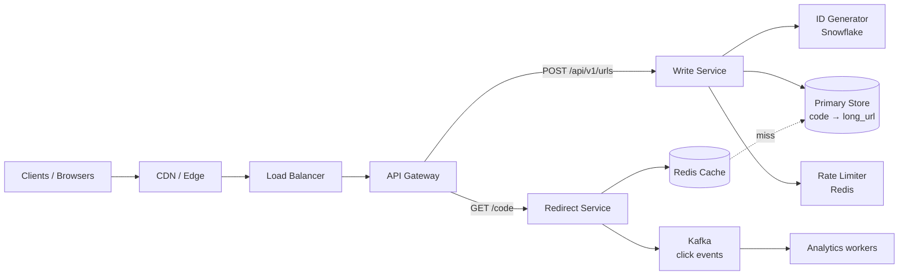
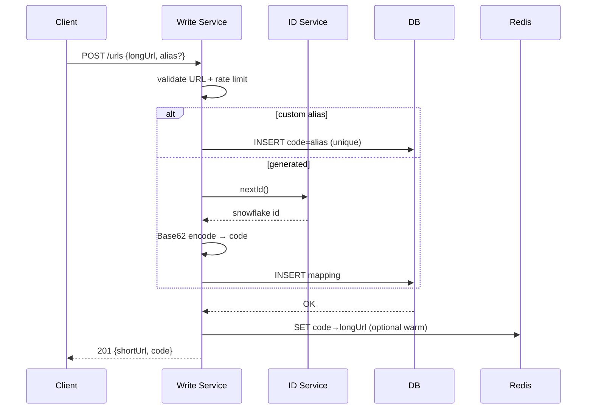
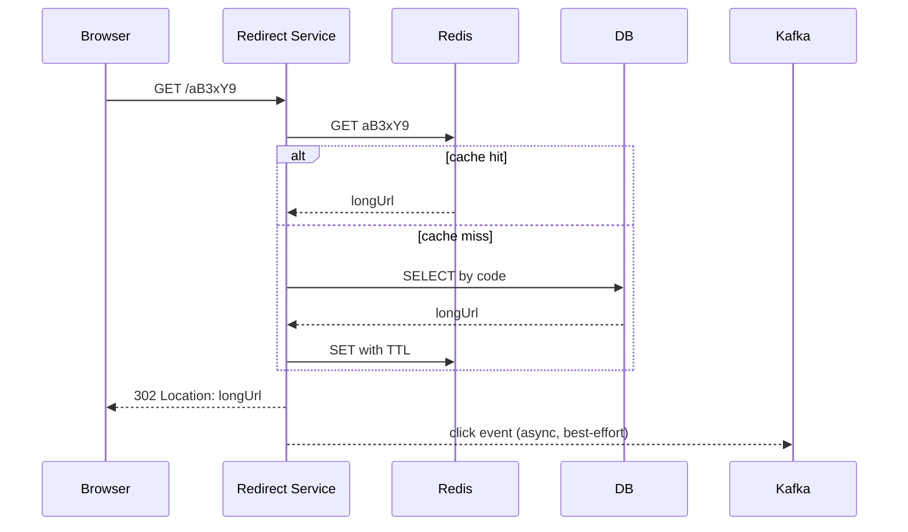

# System: URL Shortener

> Round: 00  
> Author: sample (reference)  
> Status: **accepted | sample**  
> Timebox: ориентир для драфта ~45–60 min; этот документ — полная «эталонная» версия после уточнений

Это **образец**. На следующих раундах пиши свой `DESIGN.md` без подсматривания в идеале до первого review.

---

## 1. Clarifying questions

Зафиксированные допущения (как после диалога с интервьюером):

1. Нужен публичный short link + redirect; analytics — nice-to-have, не блокирует v1 redirect.
2. Один long URL может иметь **несколько** short codes (кампании, A/B).
3. Custom alias поддерживается.
4. Ссылки по умолчанию живут долго (годы); TTL опционален.
5. Глобальная аудитория, но **один логический регион** на старте (multi-region — follow-up).
6. Read:write ≈ **100:1**; 100M новых ссылок / месяц.
7. Короткие коды не должны быть легко перебираемыми для «секретных» URL → rate limit + достаточно большой space; для чувствительных ссылок — отдельный флаг / auth (out of scope v1 deep dive).

---

## 2. Functional requirements

**In scope**

- Создать short URL из long URL
- Redirect `GET /{code}` → long URL
- Custom alias (опционально)
- Optional expiry (`expires_at`)
- Идемпотентность создания по желанию клиента (`Idempotency-Key`)

**Out of scope (v1)**

- Личный кабинет, биллинг, QR-кампании
- Real-time dashboard аналитики (только async event «click happened»)
- Превью-страницы / interstitial ads

---

## 3. Non-functional requirements

| NFR | Target |
|-----|--------|
| Availability (redirect) | 99.99% |
| Availability (create) | 99.9% |
| Latency redirect | p99 &lt; 50 ms (cache hit сильно ниже) |
| Latency create | p99 &lt; 200 ms |
| Throughput | ~40 write/s avg, ~4k read/s avg; peak ×10 |
| Durability | mapping не теряем после successful create |
| Consistency | create: strong (unique code); redirect: read-your-writes не критичен для чужих клиентов |
| Security | rate limit create; enumerate-resistant code space |

---

## 4. Capacity estimation

### Writes

```text
100M links / month
≈ 100e6 / (30 * 24 * 3600) ≈ 38.6 writes/sec average
peak ≈ 10× → ~400 writes/sec
```

Одна primary Postgres/KV спокойно тянет write path на старте.

### Reads

```text
read:write = 100:1
≈ 4 000 reads/sec average
peak ≈ 40 000 reads/sec
```

Упор на **горизонтальный scale Redirect tier + cache**.

### Storage (5 years)

```text
record ≈ code(8) + url(500) + meta(200) ≈ 0.7–1 KB
100M/month × 12 × 5 = 6B rows
6B × 1KB ≈ 6 TB raw (+ indexes ~1.5–2×) ≈ 10–12 TB
```

Нужен план шардирования **до** упирания диска, но не в день 1.

### Cache

```text
Hot set hypothesis: 20% codes → 80% traffic
Если кэшируем 200M hot mappings × 0.5KB ≈ 100 GB Redis cluster
На старте: 10–20 GB + eviction LRU уже даёт огромный hit ratio на viral + recent
```

### Bandwidth (redirect)

```text
40k rps × ~500 B response headers ≈ 20 MB/s ≈ 160 Mbps peak — скромно
```

---

## 5. High-level architecture

### Контекст



### Write path



### Read path (redirect)



**Почему split Write / Redirect:** разные SLO, разный scale factor, деплой redirect не связан с тяжёлой валидацией create.

---

## 6. API design

```http
POST /api/v1/urls
Idempotency-Key: optional-uuid
Content-Type: application/json

{
  "longUrl": "https://example.com/very/long/path",
  "customAlias": "my-launch",   // optional
  "ttlDays": 365                // optional; null = default policy
}

→ 201 Created
{
  "code": "my-launch",
  "shortUrl": "https://short.ly/my-launch",
  "expiresAt": "2027-08-20T00:00:00Z"
}

→ 409 Conflict  // alias taken
→ 429 Too Many Requests
```

```http
GET /{code}
→ 302 Found
Location: https://example.com/very/long/path
Cache-Control: no-cache   # for 302; see trade-off vs 301
```

```http
GET /api/v1/urls/{code}
Authorization: Bearer ...
→ 200 { code, longUrl, createdAt, clicksApprox? }
```

**Redirect status: выбираем `302` в v1** (см. trade-offs): нужна возможность менять destination и считать клики; CDN/browser не залипают навечно.

---

## 7. Data model

### Primary table

```sql
CREATE TABLE url_mapping (
  code         VARCHAR(32) PRIMARY KEY,  -- generated 7–8 chars or custom
  long_url     TEXT        NOT NULL,
  user_id      BIGINT      NULL,
  is_custom    BOOLEAN     NOT NULL DEFAULT FALSE,
  created_at   TIMESTAMPTZ NOT NULL DEFAULT now(),
  expires_at   TIMESTAMPTZ NULL
);

CREATE INDEX idx_url_mapping_expires ON url_mapping (expires_at)
  WHERE expires_at IS NOT NULL;
```

Access pattern: **строго KV по `code`** → идеальный PK lookup.

### Redis

```text
key:   url:{code}
value: {longUrl, expiresAt}
TTL:   min(policy, time_until_expires)  e.g. 24h for generated, longer for hot
```

### Click events (async)

```text
topic: url.clicks
key:   code
value: {code, ts, country?, ua_hash?}
```

Агрегации — отдельно (Flink/KS / batch), не на hot path.

### Namespace для custom vs generated

Чтобы custom alias не столкнулся с будущим random code:

- Generated codes: длина **8**, алфавит Base62, только из ID encoder
- Custom aliases: **3–32** символа, но **запрещаем** чисто «сгенерированный» вид *или* храним в одном PK space и полагаемся на unique constraint + reserved check
- Практичный prod-приём: **префикс/зона**
  - generated: `^[a-zA-Z0-9]{8}$` из encoder
  - custom: must contain `-` или быть в allowlist длины 3–7 **и** проверяться на reserved words (`api`, `www`, `static`…)
- При INSERT всегда `UNIQUE(code)` — источник истины против гонок

---

## 8. Deep dive

### 8.1 Генерация short code

| Подход | Вердикт |
|--------|---------|
| MD5/SHA longUrl → truncate | ❌ коллизии; один short на longUrl (нам нужно много) |
| Random 7 chars + retry | ✅ просто; при 62^7 коллизии редки, но нужны retries |
| **Snowflake → Base62** | ✅ **выбираем**: уникальность без координации на insert (почти), стабильный TPS |

Поток:

1. `id = snowflake()` (datacenter + worker + sequence)
2. `code = Base62(id)` , добиваем/берём 8 символов
3. `INSERT`; при конфликте custom alias — 409; для generated конфликт ≈ невозможен

Связь с platform-репо: паттерн как у `unique-id-generator`.

**Перебор:** 62^8 ≈ 2.1e14. При rate limit create + не угадывать redirects без смысла — ok для v1. Для confidential links позже: длиннее code или auth gate.

### 8.2 Cache-aside и viral stampede

Viral code: 500k redirects/min на один ключ.

Защита:

1. **Redis** держит значение → DB почти не видит hot key
2. **Singleflight / request coalescing** на cache miss (один inflight load на code на инстанс)
3. **Local Caffeine** (секунды) перед Redis для ultra-hot keys — снимает Redis QPS
4. Опционально **CDN** только если перейдём на 301 + cacheable responses (сейчас 302)

### 8.3 Почему не «только Cassandra» на старте

Access pattern = PK get. Postgres + Redis хватает до миллиардов строк с шардированием.  
Cassandra/Dynamo выгодны позже: multi-region AP, проще horizontal write.  
На интервью: стартуем с SQL/KV, озвучиваем эволюцию.

### 8.4 Шардирование (когда storage/IOPS упрутся)

```text
shard = hash(code) % N
```

Redirect знает shard по code.  
Range по времени — плохо для random codes.  
Resharding → consistent hashing (как `consistent-hash-router`).

---

## 9. Scaling

| Симптом | Что ломается первым | Действие |
|---------|---------------------|----------|
| Рост redirects | Redirect CPU / Redis QPS | HPA на Redirect; Redis Cluster |
| Viral single key | Redis hotspot slot | local cache; read replica не спасёт один key |
| Рост storage | Disk / vacuum / backup window | hash shard `url_mapping`; archive expired |
| Рост creates | ID service / unique index | scale ID workers; batch optional |
| Multi-region latency | RTT to one region | regional redirect caches; global DB later (follow-up) |

Эволюция:

```text
v1:  monolith modules + 1 PG + Redis
v2:  split Write/Redirect services
v3:  shard PG / move to Dynamo-style KV
v4:  multi-region active-active for redirects
```

---

## 10. Reliability & failure modes

| Failure | Impact | Mitigation |
|---------|--------|------------|
| Redis down | выше latency redirect | fallback DB; circuit breaker; cache optional |
| DB primary down | create недоступен; redirect если cache hit ок | sync standby / failover; degrade create |
| ID service down | create fails | local snowflake workers (no central SPOF); cached worker ids |
| Kafka down | analytics lag | redirect **не** зависит от Kafka (best-effort fire-and-forget / local buffer) |
| Wrong longUrl stored | bad redirect | validate URL on write; no SSRF to internal nets |
| Alias enumeration / spam | abuse | rate limit; captcha on suspicious; blocklists |
| Deploy Redirect | 5xx spike | readiness probes; graceful shutdown (модуль 10) |

**SLO split:** redirect важнее create → при деградации лучше отказать в `POST`, чем в `GET /{code}`.

---

## 11. Trade-offs & alternatives

| Decision | Chosen | Alternative | Why |
|----------|--------|-------------|-----|
| Redirect code | **302** | 301 | analytics + смена destination; ценой большего origin traffic |
| Code gen | **Snowflake→Base62** | random / hash | multi-short per longUrl; низкие коллизии |
| Store | **Postgres PK** | Cassandra first | проще ops/транзакции на старте; pattern всё равно KV |
| Cache | **Redis cache-aside** | write-through always | простой; miss безопасен |
| Analytics | **async Kafka** | sync counter in DB | redirect path не ждёт запись |
| Alias vs gen | **unique PK + rules** | separate tables | один lookup path |

---

## 12. Follow-ups (типичные вопросы интервьюера)

**Q1. Load ×10 на redirect. Что делаешь первым?**  
HPA Redirect + Redis scale; проверить hit ratio; local in-process cache для top-N; не шардировать БД первым, если cache hit высокий.

**Q2. Упала целая AZ.**  
Multi-AZ Redis + PG; Redirect/Write в 2+ AZ; LB health; RPO/RTO по async/sync replica.

**Q3. Нужна сильная аналитика «уникальные клики / день».**  
Click stream → Kafka → Flink/ClickHouse; redirect только emit event; approximate HyperLogLog для uniques.

**Q4. Пользователь сразу открывает только что созданный short link и получает 404.**  
Read-your-writes: warm cache on create **или** redirect reads primary for short TTL **или** synchronous replicate to cache before 201.

**Q5. Бюджет маленький, команда 2 инженера.**  
Один сервис (модули Write/Redirect), managed Postgres + Redis, без mesh/Kafka до появления analytics; 302, random/snowflake — без overengineering.

---

## Чеклист «что сказать вслух на интервью»

1. Уточнил FR/NFR и зафиксировал цифры.  
2. Посчитал QPS и storage.  
3. Нарисовал write vs read path.  
4. Выбрал генерацию ID и обосновал.  
5. Объяснил cache + hot key.  
6. Назвал failure modes и что деградирует первым.  
7. Явно проговорил 2–3 trade-offs.

Если это есть в документе и на схеме — раунд выглядит senior-level.
