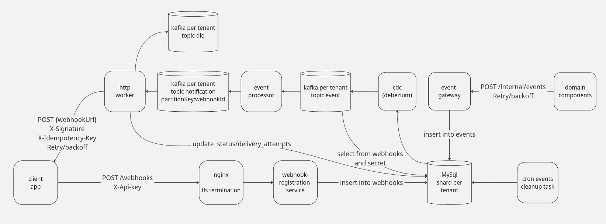

# Система: Webhook Dispatcher

> Раунд: 02
> Статус: **reviewed** (финальный review в [`REVIEW.md`](./REVIEW.md))

## 1. Уточняющие вопросы

Что спросил у интервьюера / какие assumptions зафиксировал:

- **Бизнес-логики в dispatcher нет.** Он только доставляет уже произошедшие события.
- **Кто триггерит:** доменные сервисы (Order, Payment, …) после своего use-case публикуют событие в dispatcher.
- **Ingress (v1):** `POST /internal/events` → durable write → **`202 Accepted`**. Accept **не ждёт** чужой HTTP.
- **Dual-write домен ↔ gateway:** домен **ретраит** `POST /internal/events` до `202`; тело с идемпотентным **`eventId`**.
- Таблица `events` в MySQL — durable store + outbox для CDC (outbox **доставки**, не доменной TX).
- **Регистрация webhook — must.**
- **Auth (v1):** tenant `apiKey`; на подписку `signingSecret`; outbound HMAC + `X-Idempotency-Key`.
- **`partitionKey`:** на событии от домена (бизнес-сущность).
- **Изоляция tenant (v1):** MySQL shard per tenant + Kafka topics per tenant.
- **Модель события:** один `POST /internal/events` → одна строка `events` → CDC → `topic.event`.
- **Fan-out:** компонент **`event-processor`** читает `topic.event`, делает `SELECT` webhooks, публикует **N** сообщений в **`topic.notification`** (одно на подписчика) → **http worker**.
- Dedup / статусы: **`delivery_attempts`**, ключ `eventId:webhookId`.

## 2. Функциональные требования

**Must have (v1)**

1. Регистрация / просмотр / удаление webhook (`POST/GET/DELETE /webhooks`).
2. Приём доменного события (`POST /internal/events`) с идемпотентным `eventId`.
3. Async доставка на URL подписчиков по `eventType`.
4. Подпись outbound (HMAC) + `X-Idempotency-Key`.
5. Timeout на outbound HTTP; retry с backoff; DLQ после исчерпания попыток / на non-retryable.
6. Статусы доставки (per webhook attempt).
7. Cleanup событий (и attempts) по retention.

**Nice to have**

- Auto-disable webhook после N фейлов
- UI / портал
- Inbound HMAC на API подписок
- Метрики дашборда для tenant

**Вне скоупа**

- Доменная бизнес-логика внутри dispatcher
- Exactly-once у клиента
- Сложные фильтры подписки (`amount > 1000`)

## 3. Нефункциональные требования

| NFR | Цель |
|-----|------|
| Throughput (ingress) | peak **~200 events/s** |
| Fan-out | avg **~5** подписок / event → ~**1000** outbound HTTP/s peak |
| Latency **accept** | p99 **&lt; 100 ms** |
| Latency **первой доставки** | best-effort p99 **&lt; 2–5 s** (живой endpoint) |
| Availability (accept) | **99.9%** |
| Durability | не теряем после `202` до success / max attempts / DLQ |
| Delivery semantics | **at-least-once** |
| Outbound timeout | **3–5 s** |
| Isolation | медленный URL не роняет accept и других tenant/подписчиков |
| Security | apiKey + HMAC outbound; **plaintext secret не храним в Kafka** |

**Retry policy:**
- Backoff: **1m → 5m → 30m**
- Retry: **5xx**, **timeout**, сеть
- Сразу DLQ: **400**, **410**

## 4. Оценка нагрузки (capacity estimation)

```text
Ingress peak:     200 events/s
Outbound peak:    200 × 5 ≈ 1000 HTTP/s
Accept budget:    < 100 ms → route + idempotent INSERT

Storage (грубо):
  200/s × 86_400 × ~5 KB ≈ 85 GB/day до cleanup
  → retention 7–30 дней + cron cleanup
```

## 5. High-level архитектура

Схема: 

```text
Registration:
  Client → Nginx (TLS) → webhook-registration-service
        → INSERT webhook @ MySQL shard(tenant)

Accept:
  Domain → event-gateway → INSERT events @ MySQL shard(tenant) → 202

Pipeline:
  MySQL events
    --CDC (Debezium)--> kafka topic.event (per tenant), key=partitionKey
    --> event-processor:
          SELECT webhooks WHERE eventType + active
          upsert delivery_attempts(event_id, webhook_id)
          produce N × kafka topic.notification
               { eventId, webhookId, eventType, body, url? }
               // signingSecret — НЕ в plaintext (см. §8.5)
    --> http worker (1 notification = 1 URL):
          load signingSecret(webhookId)  // DB/cache
          POST {webhookUrl}
            headers: X-Signature, X-Idempotency-Key, X-Timestamp
          update delivery_attempts
          retryable → backoff; 400/410 / max → topic.dlq

Cleanup:
  cron → retention DELETE/archive events (+ attempts)
```

**Accept path:** Domain → event-gateway → MySQL `events` → `202`.

**Delivery path:** CDC → `topic.event` → **event-processor** (enrich + fan-out) → N× `topic.notification` → **http worker** → client / DLQ.

### Улучшения к схеме (приняты в текст)

1. **Не класть raw `signingSecret` в `topic.notification`.**  
   Обогащение URL/`webhookId`/payload — ок; подпись — после lookup секрета в worker (или encrypted envelope). Иначе secret живёт в retention Kafka, бэкапах, логах консьюмеров.
2. Явно показать **`delivery_attempts`** / update статуса из http worker (на jpg пока только поток топиков).
3. Key в `topic.notification`: **`partitionKey:webhookId`** — порядок агрегата на URL без блокировки других URL.
4. На схеме регистрации полезно подписать `X-Api-Key` и что secret возвращается **в body** `201`.
5. Cleanup — и `events`, и старые `delivery_attempts`.
6. При смене URL/secret webhook: in-flight notification со старым URL устареет — worker может **re-fetch webhook by id** перед POST (рекомендуется).

## 6. API

### Подписки (tenant)

```http
POST /webhooks
X-Api-Key: <tenantApiKey>

{
  "eventType": "order.paid",
  "url": "https://customer.example/hooks/orders"
}

→ 201 Created
{
  "id": "wh_123",
  "eventType": "order.paid",
  "url": "https://customer.example/hooks/orders",
  "signingSecret": "<one-time show>"
}

GET    /webhooks/{id}     // без signingSecret
DELETE /webhooks/{id}
```

### События (internal)

```http
POST /internal/events

{
  "eventId": "evt_01H...",
  "tenantId": "ten_...",
  "eventType": "order.paid",
  "partitionKey": "order_42",
  "body": { ... },
  "occurredAt": "2026-09-15T..."
}

→ 202 Accepted
→ 200 OK    // повтор того же eventId
```

Нет подписок: всё равно `202`; event-processor произведёт 0 notification.

### Outbound к клиенту

```http
POST {webhookUrl}
X-Signature: sha256=...
X-Idempotency-Key: {eventId}:{webhookId}
X-Timestamp: ...

{
  "eventType": "order.paid",
  "eventId": "evt_01H...",
  "body": { ... }
}
```

## 7. Модель данных

**Per-tenant MySQL shard**

`webhooks` — `id`, `event_type`, `url`, sealed/`signing_secret`, `status`, `created_at`

`events` — `event_id` UNIQUE, `event_type`, `partition_key`, `body`, `created_at`

`delivery_attempts` — UNIQUE(`event_id`, `webhook_id`); status; attempts; next_attempt_at; last_error;  
`idempotency_key` = `{eventId}:{webhookId}`

**Kafka (per tenant):**
- `topic.event` — CDC; key = `partitionKey`
- `topic.notification` — после event-processor; **1 msg = 1 subscriber**; key = `partitionKey:webhookId`
- `topic.dlq` — non-retryable / max attempts для notification

Payload notification (рекомендуемый):
```json
{
  "eventId": "...",
  "webhookId": "...",
  "eventType": "order.paid",
  "partitionKey": "order_42",
  "url": "https://...",
  "body": { }
}
```
Без plaintext secret.

## 8. Deep dive

### 8.1 Ordering

- `topic.event`: key = `partitionKey`
- `topic.notification`: key = `partitionKey:webhookId`

### 8.2 event-processor = enrich + fan-out

```text
consume topic.event
  → webhooks = SELECT ... event_type AND active
  → for each webhook:
        upsert delivery_attempts(event_id, webhook_id)
        produce topic.notification { eventId, webhookId, url, body, ... }
  → commit offset

http worker:
  → optional re-fetch webhook (свежий url/status)
  → secret = lookup(webhookId)
  → POST + HMAC + idempotency key
  → update delivery_attempts
```

Имя на схеме: **event-processor** (то же, что ранее называли Fanout service).

### 8.3 Idempotency

| Слой | Ключ |
|------|------|
| Accept | `eventId` |
| Fan-out | UNIQUE(`event_id`, `webhook_id`) |
| Outbound | `X-Idempotency-Key: eventId:webhookId` |

### 8.4 Retry / DLQ

Retryable → backoff 1m / 5m / 30m на **notification**-пути.  
400/410 / max attempts → **`topic.dlq`**.  
Не ретраим весь исходный event целиком из‑за одного URL.

### 8.5 Secret handling (важно)

На схеме processor «обогащает секретом» — удобно для worker, но **плохо для security**:

| Подход | Вердикт |
|--------|---------|
| plaintext secret в `topic.notification` | ❌ не берём |
| только `webhookId` (+ опционально url), secret lookup в worker | ✅ **выбрано** |
| encrypted secret в сообщении (KMS envelope) | ✅ ok, если очень нужен offline worker |

Также: не логировать secret; one-time show при `POST /webhooks`.

### 8.6 Зачем тогда enrichment url в processor?

Чтобы http worker меньше ходил в БД на каждый POST. Компромисс: url может устареть → **re-fetch by webhookId** перед отправкой (или при 404/410 от клиента после смены endpoint).

## 9. Масштабирование

| Рост | Действие |
|------|----------|
| ×10 ingress | scale event-gateway; CDC; partitions `topic.event` |
| Fan-out | scale **event-processor**; partitions `topic.notification` |
| Outbound | scale **http worker** |
| Медленные tenants | уже изолированы per-tenant topics/shards |
| Topic explosion | shared topics + tenant_id, если tenants тысячи |
| Storage | жёстче retention |

## 10. Надёжность и failure modes

| Сбой | Влияние | Митигация |
|------|---------|-----------|
| Customer URL down | delayed delivery | retry/DLQ; accept жив |
| event-gateway down | нет 202 | домен retry |
| CDC / event-processor lag | доставка позже | мониторинг lag; events уже durable |
| event-processor дублирует fan-out | лишние notification | UNIQUE attempts + worker dedup |
| Secret утечёт через Kafka | компрометация подписи | не пишем plaintext secret в топик |
| Webhook URL сменили | stale url в notification | re-fetch webhook перед POST |
| Poison 400 | | сразу DLQ |
| Duplicate domain POST | | UNIQUE `eventId` |

## 11. Trade-offs и альтернативы

| Решение | Выбрано | Альтернатива | Почему |
|---------|---------|--------------|--------|
| Ingress | HTTP + MySQL + CDC → Kafka | Domain → Kafka напрямую | простой контракт домена |
| Tenant isolation | shard + topics **per tenant** | shared + tenant_id | изоляция; выше ops |
| Fan-out component | **event-processor** → N× notification | N URL в одном HTTP loop | независимый retry/scale |
| Enrichment | metadata (+ url); **secret lookup в worker** | secret в Kafka plaintext | безопасность vs удобство |
| Notification name | `topic.notification` | `topic.deliveries` | как на схеме |
| Attempts state | MySQL `delivery_attempts` | только Kafka | статусы + dedup |
| partitionKey | на event | на webhook | порядок по агрегату |
| Secret в create | body `201` | header | меньше access-log leak |

## 12. Follow-ups (после review)

Полный разбор также в [`REVIEW.md`](./REVIEW.md).

### 1. Lag CDC / event-processor (например 10 минут)

**Ответ:** Accept уже успешен — событие в MySQL (`events`), домен получил `202`. Доставка eventual: клиенты получат webhook позже.

Где копятся данные:
- CDC не читает → давление на WAL/binlog / replication slot;
- CDC ок, processor отстаёт → lag `topic.event`;
- workers медленные → lag `topic.notification`.

Действия: мониторинг accept success, CDC lag, consumer lag, DLQ depth; scale bottleneck; не теряем данные — source of truth MySQL до cleanup.

**Фраза:** lag бьёт по SLO *доставки*, не по durability accept.

### 2. Один `eventType` × 10k webhooks

**Ответ:** Наивный fan-out даст 10k produce + 10k HTTP на один event.

Защита:
1. Product limits — max webhooks на tenant / на `eventType`;
2. Backpressure в event-processor (limit concurrent produce);
3. Slow lane / отдельный пул для огромного fan-out;
4. Batch produce в `topic.notification`;
5. На экстремуме — один URL у клиента (их внутренняя шина), а не 10k наших HTTP.

**Фраза:** деградация через лимиты подписок важнее героического fan-out.

### 3. Глобальный порядок всех событий tenant

**Ответ:** Обещаем порядок по **`partitionKey` (агрегат)** и по **`partitionKey:webhookId`** в notification.

Глобальный порядок на весь tenant ≈ одна partition → нет параллелизма, один медленный путь тормозит всё.

Обычно бизнесу нужен порядок по заказу/пользователю, не total order компании. Если must — single-partition + честный trade-off throughput, либо клиент упорядочивает по `occurredAt`/`sequence`.

**Фраза:** global total order и горизонтальный scale почти несовместимы — уточняем реальный requirement.

### 4. Ротация `signingSecret` без даунтайма

**Ответ:**
1. `POST /webhooks/{id}/rotate-secret` → новый secret; старый valid ещё grace period (dual-secret);
2. Клиент обновляет проверку (принимает оба в окне);
3. Worker при отправке делает **lookup secret by webhookId** → подписывает current (не secret из Kafka);
4. После grace — invalidate previous.

Аргумент не класть plaintext secret в Kafka: in-flight сообщения не содержат устаревший/утёкший секрет в брокере.

**Фраза:** ротация = dual-secret window + lookup на send, не restart workers.

### 5. CDC vs прямой produce в Kafka из event-gateway

| | CDC (выбрано) | Прямой produce после INSERT |
|---|---|---|
| Dual-write DB↔Kafka | нет | риск «DB ok, Kafka fail» |
| Replay | из MySQL / snapshot | сложнее |
| Latency доставки | + CDC lag | ниже |
| Ops | Debezium, slots | проще стек |

Прямой produce ок на малом масштабе + outbox-poller. CDC оправдан: «INSERT в events ⇒ гарантированно уедет в Kafka» без второго write в API-пути.

**Фраза:** CDC — outbox без publisher-кода в gateway; платим ops и lag за отсутствие dual-write.
